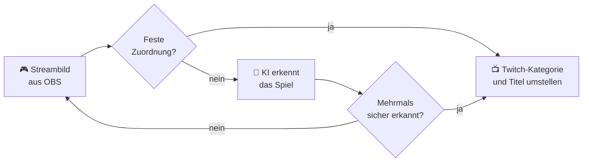

<div align="center">

# 🎮 KI Game Switcher für OBS

**Du wechselst das Spiel, dein Stream zieht automatisch mit.**

Das OBS-Plugin erkennt per KI, was gerade in deinem Stream läuft, und stellt **Twitch-Kategorie und -Titel** von selbst um. Kostenlos, ohne API-Key, direkt in OBS.

[](https://github.com/BellocccYT/ki-game-switcher/releases/latest)
[](https://github.com/BellocccYT/ki-game-switcher/releases)
[](https://obsproject.com)
[](LICENSE)

### [⬇️ Setup für Windows herunterladen](https://github.com/BellocccYT/ki-game-switcher/releases/latest)

</div>

---

## ✨ Was es kann

| | |
|---|---|
| 🧠 **KI auf deinem PC** | Standardmäßig rechnet Ollama lokal auf deiner Grafikkarte: kostenlos, ohne Account, ohne Limits. Kein Bild verlässt deinen PC. |
| 👀 **Erkennt am echten Streambild** | Die KI sieht genau das, was deine Zuschauer sehen. Das klappt auch mit Konsole, Capture-Card oder Emulator. |
| 🛡️ **Kein nervöses Hin- und Herspringen** | Gewechselt wird erst nach mehreren sicheren Erkennungen hintereinander. Ein kurzer Alt-Tab zu Discord löst nichts aus. |
| ✍️ **Titel in deinem Stil** | Die KI schreibt ihn passend zum Spiel, oder du nimmst eine Vorlage wie `{game} – live! 🎮`. |
| 🎯 **100 % sicher mit Zuordnungen** | `javaw.exe → Minecraft` einmal festlegen, dann wird ganz ohne KI sofort umgestellt. |
| 🖥️ **Eigenes Dock in OBS** | Live-Status, Vorschaubild, Verlauf, „Jetzt prüfen“, „Test“, Pause und „Falsch erkannt?“ |

## ⚙️ So funktioniert's



Geprüft wird standardmäßig **nur während du live bist**, einmal pro Minute, und sofort beim Go-Live.

## 🚀 Installation (Windows)

1. **[Setup herunterladen](https://github.com/BellocccYT/ki-game-switcher/releases/latest)** (`ki-game-switcher-…-windows-x64-setup.exe`) und starten.
2. Haken bei **„Ollama installieren und Bildmodell laden“** lassen. Damit bekommst du die kostenlose KI gleich mit. Das sind ca. 4,9 GB Download, und deine Grafikkarte braucht mindestens 4 GB Speicher.
3. OBS starten. Das Dock **KI Game Switcher** erscheint automatisch.
4. Im Dock auf **Einstellungen … → Twitch → Mit Twitch verbinden** klicken. Fertig! 🎉

> [!NOTE]
> **Windows meldet „Der Computer wurde durch Windows geschützt“?** Das Setup ist noch nicht digital signiert. Klick auf **Weitere Informationen → Trotzdem ausführen**.

> [!WARNING]
> **„Fehler beim Laden von Plugins“?** Unter Windows 11 blockiert die *Intelligente App-Steuerung* (Smart App Control) unsignierte Plugins. Im OBS-Log steht dann `LoadLibrary failed … (4551)`. Bis es eine signierte Version gibt, hilft nur, die Intelligente App-Steuerung abzuschalten (Windows-Sicherheit → App- & Browsersteuerung).

Voraussetzung ist **OBS Studio 31 oder neuer**. Deinstallieren kannst du über **Windows-Einstellungen → Apps**. Ollama und deine Einstellungen bleiben dabei erhalten.

<details>
<summary>Manuell mit der ZIP-Datei installieren</summary>

1. Unter [Releases](https://github.com/BellocccYT/ki-game-switcher/releases/latest) die Datei `ki-game-switcher-…-windows-x64.zip` herunterladen
2. OBS schließen
3. Den Inhalt der ZIP nach `C:\ProgramData\obs-studio\plugins\` entpacken. Danach existiert `C:\ProgramData\obs-studio\plugins\ki-game-switcher\bin\64bit\ki-game-switcher.dll`.
4. Ollama von [ollama.com](https://ollama.com) installieren und `ollama pull qwen3-vl:4b-instruct` ausführen
5. OBS starten → **Docks → KI Game Switcher**

</details>

<details>
<summary>macOS und Linux (experimentell)</summary>

Die Releases enthalten auch Pakete für macOS und Ubuntu. Sie werden automatisch gebaut, wurden aber noch nicht auf echten Geräten getestet. Rückmeldungen sind sehr willkommen!

</details>

## 🧪 Ausprobieren

Starte ein Spiel und klicke im Dock auf **Test**. Du siehst dann das Bild, das die KI bekommen hat, und was sie erkannt hat. Auf Twitch wird dabei nichts geändert.

## 🧠 KI-Anbieter

Einstellen kannst du das unter **Einstellungen … → KI**.

| Anbieter | Kosten | Was du brauchst |
|---|---|---|
| **Ollama** ⭐ Standard | kostenlos, lokal, ohne Key und ohne Limits | [Ollama](https://ollama.com) und `ollama pull qwen3-vl:4b-instruct` (3,3 GB). Das Setup erledigt beides für dich. Braucht ca. 4 GB Grafikspeicher. Auf einer RX 6750 XT dauert eine Prüfung ca. 6–7 s. |
| **Google Gemini** | in der EU, der Schweiz und Großbritannien laut Googles API-Bedingungen nur kostenpflichtig (Google-Cloud-Projekt mit Abrechnung) | API-Key von [aistudio.google.com/apikey](https://aistudio.google.com/apikey) |
| **OpenRouter** | kostenlose Modelle verfügbar | Key von [openrouter.ai/keys](https://openrouter.ai/keys). Ohne Guthaben nur ca. 50 Anfragen am Tag, Intervall daher mindestens 5 Minuten. |
| **Anthropic Claude** | kostenpflichtig | Key von [platform.claude.com](https://platform.claude.com) |
| **Eigener Server** | – | Jede OpenAI-kompatible Schnittstelle, z. B. LM Studio |

Bei Online-Anbietern prüfst du den Key mit **Modelle laden** und wählst dabei gleich ein Modell aus. Ist das Hauptmodell überlastet oder hat es sein Limit erreicht, springt automatisch das **Ersatzmodell** ein.

## 🎯 Genauer erkennen

- **Feste Zuordnungen:** Im Reiter **Zuordnungen** legst du fest, welches Programm zu welcher Twitch-Kategorie gehört. „Aktuelle Aufnahmen übernehmen“ trägt die gerade aufgenommenen Programme automatisch ein.
- **Falsch erkannt?** Im Dock setzt du die richtige Kategorie sofort. Auf Wunsch merkt sich das Plugin die Zuordnung. Ohne „Merken“ stellt die KI danach 15 Minuten lang nicht um.
- **Programm-Hinweise:** Die KI erfährt, welche Programme OBS aufnimmt, samt Fenstertitel. Bei Emulatoren wie Dolphin steht dort meist das laufende Spiel.
- **Nur die Spielaufnahme zeigen:** Unter **Erkennung → Bildquelle** deine Spielaufnahme wählen. Dann lenken Webcam, Overlays und Browserfenster nicht ab.

<details>
<summary>📋 Alle Einstellungen</summary>

| Reiter | Einstellung | Bedeutung |
|---|---|---|
| Erkennung | Prüfintervall | Abstand zwischen zwei Prüfungen (Standard 60 s) |
| | Bildquelle | Programmausgabe oder eine einzelne Quelle |
| | Mindest-Sicherheit | Unsichere Erkennungen werden ignoriert |
| | Bestätigungen | So oft hintereinander muss ein neues Spiel erkannt werden (Standard 2) |
| | Ohne Spiel | z. B. `Just Chatting`, wenn kein Spiel zu sehen ist. Leer lassen, dann bleibt die Kategorie. |
| | Aktives Fenster mitsenden | Fenstertitel und Prozessname als Hinweis an die KI |
| Titel | Titel | KI schreibt ihn, eine Vorlage wird verwendet oder der Titel bleibt unverändert |
| | Stil für KI-Titel | Freitext, z. B. „Kurz und witzig, immer mit ‚!discord‘ am Ende“ |

</details>

## 🔒 Datenschutz

- **Mit Ollama (Standard) verlässt kein Bild deinen PC.**
- Bei Online-Anbietern geht pro Prüfung ein verkleinertes Standbild deines Streams an den Anbieter. Das ist genau das, was deine Zuschauer ohnehin sehen. Ist „Aktives Fenster mitsenden“ an, kommen Fenstertitel und Prozessname dazu. Fenstertitel können private Infos enthalten, z. B. Browser-Tabs. Es gelten die Datenschutzbedingungen des Anbieters.
- Twitch erlaubt dem Plugin nur, Titel und Kategorie deines Kanals zu ändern (`channel:manage:broadcast`).
- API-Keys und der Twitch-Login liegen nur lokal in `%APPDATA%\obs-studio\plugin_config\ki-game-switcher\`. **Trennen** löscht den Twitch-Login.

## 🛠️ Fehlerbehebung

Meldungen erscheinen im Dock und im Verlauf, Details stehen im OBS-Log (**Hilfe → Protokolldateien**).

| Meldung | Lösung |
|---|---|
| `Ollama nicht erreichbar` | Läuft Ollama (Symbol im Infobereich der Taskleiste)? Ist das Modell geladen? |
| `Kein Bild` | Läuft das Spiel? Zeigt OBS die Spielaufnahme an? |
| `API-Key ungültig` | Key in den Einstellungen prüfen, dann „Modelle laden“ |
| `Modell nicht gefunden` | „Modelle laden“ und ein Modell aus der Liste wählen |
| `… ist gerade überlastet` / `antwortet nicht` | Der Anbieter ist ausgelastet. Das Ersatzmodell springt ein, sonst klappt es meist bei der nächsten Prüfung. |
| `Limit für … erreicht` | Kontingent aufgebraucht. Intervall erhöhen oder später wieder versuchen. |
| `Twitch-Anmeldung abgelaufen` | Nach 30 Tagen ohne Nutzung neu verbinden |

Ein Fehler oder eine Idee? Schreib ein [Issue](https://github.com/BellocccYT/ki-game-switcher/issues)!

## 🧑‍💻 Selbst bauen

<details>
<summary>Anleitung für Entwickler</summary>

Voraussetzungen unter Windows: Visual Studio 2022 (oder Build Tools) mit C++-Workload und Windows SDK 10.0.22621, CMake ≥ 3.28.

```bash
cmake --preset windows-x64
```

```bash
cmake --build --preset windows-x64 --config RelWithDebInfo
```

Die DLL landet in `build_x64/RelWithDebInfo/`. Den Installer baust du mit [Inno Setup 6](https://jrsoftware.org/isinfo.php), nachdem du das Plugin mit `cmake --install build_x64 --config RelWithDebInfo --prefix release/RelWithDebInfo` bereitgelegt hast:

```bash
ISCC.exe /DAppVersion=1.0.0 installer/ki-game-switcher.iss
```

Für macOS und Linux gibt es die Presets `macos` und `ubuntu-x86_64`. Die GitHub-Actions-Workflows bauen alle drei Plattformen samt Windows-Setup automatisch und hängen bei Tags die Pakete an ein Release.

Das Projekt basiert auf der offiziellen [obs-plugintemplate](https://github.com/obsproject/obs-plugintemplate).

</details>

## 📄 Lizenz

GPL-2.0-or-later, siehe [LICENSE](LICENSE). Nicht offiziell mit OBS Project, Twitch, Ollama oder den KI-Anbietern verbunden.

<div align="center">

Gemacht mit 💜 von **Belloccc**

</div>
